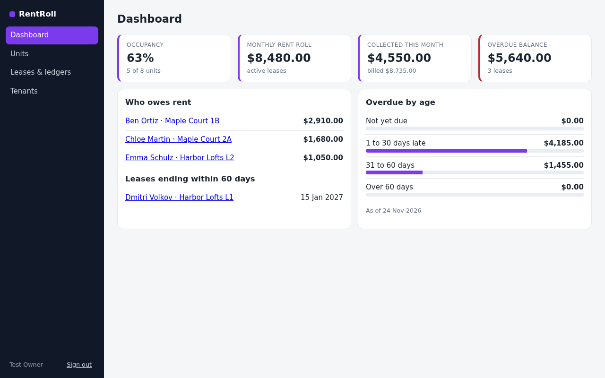
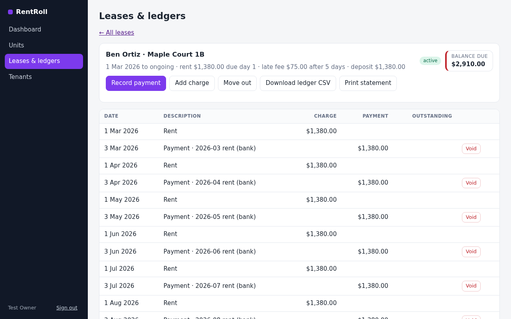
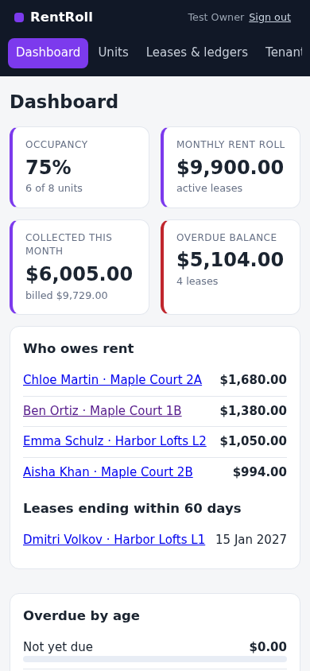

# RentRoll

Property rent ledger: leases, prorated first month, FIFO payment allocation, late fees and aging.

_Screenshots of the running app with fictional demo data (captured from the real app in Chrome)._

**Status: local demo, fictional data, not security-reviewed.**

## Features
- Leases and tenants
- Proration, charges and ledger
- FIFO payment allocation
- Late fees and aging buckets

## Run
Requires Node 22+ (no npm install needed).

    node server.js        # http://127.0.0.1:3000 (PORT overrides; HOST is loopback unless you set it)
    npm test              # unit and API tests
    npm run e2e           # browser test, needs google-chrome
    node docs/overflow-check.js   # phone layout: no sideways page scroll at 390 and 320 px

First run: open the page and create the owner account (username, name, password of 10+ characters). There is no built-in or default account. Setup works once per database; after that it is a normal sign-in.

## Honest limits
- Fictional seed data, local use only.
- Not security-reviewed. No HTTPS, no password reset, a single owner role. Do not expose it to a network without a reverse proxy with HTTPS and your own review.
- Tests and browser checks create a throwaway owner with a random in-memory password; nothing credential-like is stored in the repo.
- Late fees and grace days are per-lease settings (examples, not legal advice). The rules are demo policy and not jurisdictional compliance: local law may cap fees, set notice periods or restrict deposits.
- No bank or card payments; no tenant portal.
- Data lives in a local sqlite file; back it up yourself.
